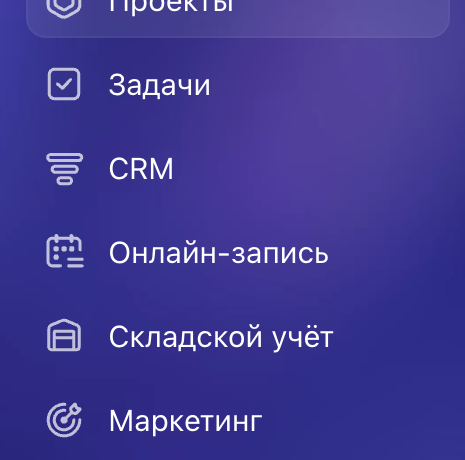
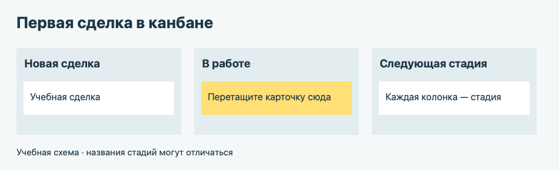

# Урок 1. Первые шаги в Битрикс24

**Цель** — войти в учебный Битрикс24, добавить клиента, создать сделку и перевести её на следующую стадию. Работайте в браузере на компьютере. Для упражнения достаточно бесплатного тарифа.

## 1. Зарегистрируйтесь и войдите

1. Откройте [страницу регистрации Битрикс24](https://www.bitrix24.ru/register/).
2. Нажмите **«Зарегистрироваться бесплатно»**. Введите адрес электронной почты и нажмите **«Продолжить»**.
3. Откройте письмо от Битрикс24. Перейдите по ссылке подтверждения и установите пароль. Если письма нет во входящих, проверьте папку «Спам».
4. Откройте адрес своего Битрикс24 из письма. Это ваш **портал** — рабочее пространство, в котором находится CRM.

## 2. Создайте первую сделку

В левом меню нажмите **CRM**.

**Ситуация.** В учебную компанию «ГородМаркет» обратился покупатель Алексей Орлов. Он хочет заказать офисное кресло за 12 000 рублей.

1. Откройте **CRM → Сделки**. Если сделки показаны списком, выберите вид **«Канбан»**. Это доска, на которой каждая колонка обозначает стадию работы.
2. Нажмите **«Создать»**. Если работаете на общем портале, добавьте свою фамилию к названию сделки.
3. Заполните поля карточки.
   - **Название** — «Учебная сделка — офисное кресло».
   - **Сумма** — `12000`.
   - **Клиент → Контакт** — введите «Алексей Орлов» и выберите **«Создать новый контакт»**. Для упражнения достаточно вымышленного имени.
4. Нажмите **«Сохранить»**. Найдите карточку в первой колонке канбана.
5. Представьте, что менеджер начал уточнять детали заказа. Перетащите карточку на следующую незавершённую стадию. Название колонки может отличаться от схемы. Снова откройте сделку и проверьте, что клиент и сумма сохранились.

**Что показать преподавателю** — карточку сделки, где видны её название, клиент, сумма и текущая стадия.

## Официальные инструкции

- [Регистрация по электронной почте со скриншотами](https://www.bitrix24.ru/register/)
- [Как привязать контакт к сделке](https://helpdesk.bitrix24.ru/open/27912504/)
- [Как начать работать с CRM в Битрикс24](https://helpdesk.bitrix24.ru/open/26035204/)
- [Как создать сделку](https://helpdesk.bitrix24.ru/open/26161116/)
- [Как работать с канбаном](https://helpdesk.bitrix24.ru/open/21839648/)

Если хотите потренироваться создавать контакт отдельно и связать его с компанией, откройте [урок 4](04-crm-records.md).

[К оглавлению](README.md) · [Дальше — урок 2. Поле и автоматическая задача](02-automation.md)
