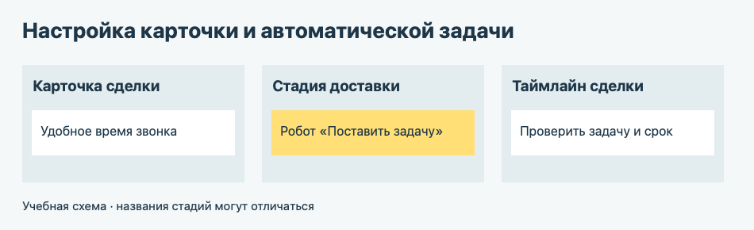

# Урок 2. Новое поле и автоматическая задача

Клиент попросил звонить после обеда. Добавим в карточку место для этой записи, а при назначении доставки CRM сама поставит менеджеру задачу.

## 1. Добавьте поле в карточку

1. Откройте **CRM → Сделки** и выберите учебную сделку из первого урока.
2. Внизу блока с полями сначала нажмите **«Выбрать поле»** и проверьте, есть ли уже «Удобное время звонка». Если поле есть, добавьте его в карточку и перейдите к шагу 3. Если поля нет, нажмите **«Создать поле»**. Выберите тип **«Строка»**, чтобы можно было записать интервал.
3. Если создаёте поле, назовите его **«Удобное время звонка»** и сохраните. Впишите **«с 15:00 до 17:00»** и сохраните карточку.
4. Закройте и снова откройте карточку. Проверьте, что значение осталось в поле.

[Где настраивать поля карточки CRM](https://helpdesk.bitrix24.ru/open/22804914/)

## 2. Добавьте робота на стадию

Для настройки нужны права на изменение карточки и автоматизации. Если вы работаете на общем портале, выполняйте настройку в учебной воронке, которую указал преподаватель.

1. Найдите в канбане стадию **«Доставка назначена»**. Если её нет, добавьте её кнопкой **«+»** между стадиями или попросите преподавателя подготовить её.
2. В разделе **«Сделки»** откройте **«Роботы»**. В колонке **«Доставка назначена»** добавьте робота **«Поставить задачу»** из группы **«Управление задачами»**.
3. Назовите задачу **«Подтвердить доставку с клиентом»**. В описании напишите **«Откройте сделку и проверьте удобное время звонка»**.
4. Укажите исполнителем **ответственного за сделку**. В параметре **«Когда»** выберите запуск **сразу**. Отдельно откройте настройки времени в поле **«Крайний срок»** и задайте относительный срок **через два часа**. Сохраните настройки. Если доступна только фиксированная дата, отметьте это преподавателю: она не заменяет относительный срок.

[Робот «Поставить задачу»](https://helpdesk.bitrix24.ru/open/22892250/) · [Настройка времени в роботах](https://helpdesk.bitrix24.ru/open/20979178/)

На общем портале сначала проверьте, есть ли на стадии робот с таким названием. Если преподаватель или другая пара уже настроили его, используйте имеющегося робота для проверки.

## 3. Проверьте результат

1. Используйте сделку из урока 1, если она ещё не на стадии «Доставка назначена». Если она уже там, создайте новую учебную сделку на начальной стадии. Проверьте, что задачи **«Подтвердить доставку с клиентом»** ещё нет.
2. Переместите сделку на стадию **«Доставка назначена»**. Откройте карточку и найдите созданную задачу в ленте событий справа.
3. Откройте задачу. Проверьте название, исполнителя и крайний срок. Если задача не появилась, откройте вкладку **«Роботы»** в карточке сделки и проверьте статус запуска.

Если демо закончилось или робот недоступен, поле можно отработать отдельно. Затем создайте задачу вручную из карточки сделки и отметьте, что автоматический запуск не проверяли. [Как создать задачу из CRM](https://helpdesk.bitrix24.ru/open/24212648/)

## 4. Обновите инструкцию для менеджера

Добавьте в руководство короткий раздел о новом поле и задаче. Напишите, куда вписывать время звонка, на какой стадии появляется задача и где смотреть её срок. Поставьте **версию 1.1**, дату и внесите обе доработки в список изменений.

**Что показать преподавателю** — карточку с заполненным полем, связанную задачу и обновлённую страницу руководства.

[К оглавлению](README.md) · [Дальше — урок 3. История изменений](03-crm-history.md)
