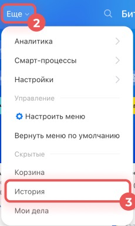
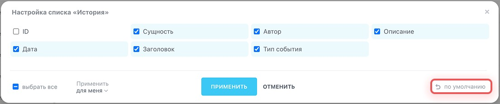

# Урок 3. Как найти изменение в истории CRM

В предыдущем уроке вы создали задачу при переходе сделки на стадию «Доставка назначена». Теперь выясним, кто и когда изменил стадию учебной сделки.

## 1. Подготовьте событие

1. Откройте **CRM → Сделки** и найдите свою учебную сделку из [урока 2](02-automation.md).
2. Посмотрите, на какой стадии она сейчас. Если помните переход из прошлого урока, используйте его. Если события ещё нет, возьмите новую учебную сделку и переместите её на следующую рабочую стадию.
3. Откройте карточку и запишите её название. Если в адресе карточки виден путь вида `/crm/deal/details/123/`, запишите число в конце. Это ID сделки. В вашей карточке число будет другим.

## 2. Найдите запись

На втором снимке показано, где находится фильтр. Для упражнения выберите свою сделку по ID или полю «Элемент CRM».

1. В основном меню CRM откройте **Ещё → История**.
2. Откройте фильтр над списком. В поле **ID** укажите номер своей сделки. Если номера нет под рукой, воспользуйтесь полем **Элемент CRM** и выберите сделку из списка. Примените фильтр.
3. Найдите строку об изменении стадии. По записи определите, что изменилось, кто внёс изменение и когда это произошло. Если нужных столбцов нет, нажмите шестерёнку в левом верхнем углу списка, включите нужные поля и примените настройки для себя.
4. Если список пуст, уберите лишние условия фильтра, проверьте ID и повторите поиск. Если запись по-прежнему отсутствует, попросите преподавателя проверить доступ к сделке и ведение истории.

*Скриншоты — фрагменты [официальной справки Битрикс24](https://helpdesk.bitrix24.ru/open/24296386/).*

Сотрудник видит события по доступным ему записям. Журнал доступа сотрудников к данным зависит от тарифа. Для упражнения достаточно события об изменении стадии. [Официальная инструкция Битрикс24 со скриншотами меню и фильтров](https://helpdesk.bitrix24.ru/open/24296386/)

## 3. Сравните с таймлайном

Вернитесь в карточку той же сделки. Справа находится **таймлайн** — лента событий по этой карточке. Если в уроке 2 сработал робот, найдите в ленте созданную задачу и откройте её. В общем разделе **«История»** вы искали изменение стадии, а в карточке проверяете связанную задачу и её детали. [Карточка CRM и таймлайн — официальная инструкция со скриншотами](https://helpdesk.bitrix24.ru/open/22804914/) · [Как увидеть результат работы робота](https://helpdesk.bitrix24.ru/open/22892250/)

**Что показать преподавателю** — запись из истории своей учебной сделки и короткое объяснение: кто, когда и что изменил. Если автоматическая задача доступна, покажите и её в таймлайне.

[К оглавлению](README.md) · [Дальше — урок 4. Как создать записи с нуля](04-crm-records.md)
