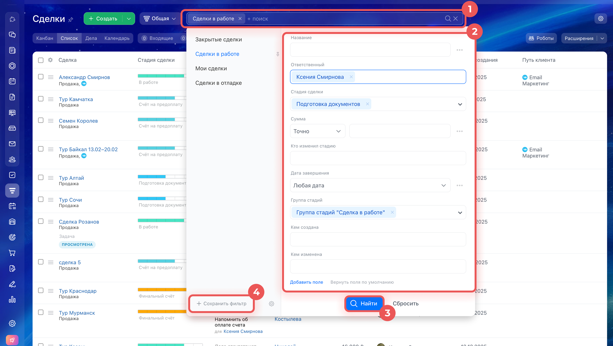

# Урок 5. Поиск и фильтры в CRM

Откройте в браузере свой Битрикс24 из урока 1. Сегодня вы найдёте одну сделку по названию и сохраните фильтр по её стадии.

## 1. Подготовьте две сделки

1. Откройте **CRM → Сделки → Канбан**. Канбан — доска с колонками. Название каждой колонки — это **стадия сделки**.
2. Найдите свои карточки **«Учебная сделка — офисное кресло»** и **«Учебный заказ — мебель для Маяка»**. Если какой-то карточки нет, нажмите **«Создать»**, введите её название и нажмите **«Сохранить»**. Создавайте обе карточки в одной воронке.
3. Посмотрите, в каких колонках стоят карточки. Если обе в одной колонке, перетащите **кресло** в другую рабочую колонку. **Маяк** оставьте на месте. Если рабочая колонка только одна, добавьте через **«+»** между стадиями колонку «На проверке» и перенесите туда кресло. Если кнопки нет, попросите преподавателя помочь добавить стадию.
4. Запишите название колонки, в которой находится **Маяк**. Оно понадобится в разделе 3.

**Проверьте себя.** На одной доске видны обе карточки, каждая в своей колонке.

## 2. Найдите сделку по названию

1. Над доской нажмите **«Список»**.
2. В строке **«Фильтр + поиск»** нажмите **×** справа, если там есть старый запрос или активный фильтр.
3. Введите **Маяка** и нажмите **Enter**.
4. Найдите строку «Учебный заказ — мебель для Маяка». Откройте её двойным щелчком и проверьте название.

**Проверьте себя.** Вы открыли карточку заказа для Маяка.

## 3. Отберите сделки по стадии

На скриншоте показаны кнопки из официальной справки. Имена и названия стадий на нём служат примером. В упражнении используйте стадию, которую записали в разделе 1.

1. Вернитесь к списку сделок. Уберите запрос **Маяка** кнопкой **×** справа в строке поиска.
2. Щёлкните строку **«Фильтр + поиск»**. Если там уже выбраны условия, нажмите **«Сбросить»** рядом с кнопкой **«Найти»**. Если окно закрылось, откройте его снова.
3. Найдите поле **«Стадия сделки»**. Если его нет, нажмите **«Добавить поле»** и выберите **«Стадия сделки»**.
4. Выберите записанную стадию **Маяка**. Остальные поля оставьте пустыми. Если в полях «Ответственный» или «Группа стадий» остались значения, уберите их крестиком.
5. Нажмите **«Найти»**.

**Проверьте себя.** Маяк виден, кресло скрыто. Другие сделки на стадии Маяка тоже могут отображаться. Фильтр только управляет тем, какие строки видны. Если Маяка нет, повторите шаги 2–5 и проверьте название выбранной стадии.

[Официальная справка Битрикс24 о списке сделок и фильтрах](https://helpdesk.bitrix24.ru/open/27405366/)

## 4. Сохраните фильтр и проверьте его

1. Снова щёлкните **«Фильтр + поиск»**. Убедитесь, что выбрана стадия Маяка.
2. Нажмите **«Сохранить фильтр»** внизу слева. Введите название **«Учебный фильтр — стадия Маяка»** и нажмите **«Сохранить»**.
3. Снимите фильтр крестиком **×** справа в строке поиска. Проверьте, что в списке снова видны обе сделки.
4. Откройте **«Фильтр + поиск»** и выберите слева **«Учебный фильтр — стадия Маяка»**.

**Проверьте себя.** Маяк снова виден, кресло скрыто.

**Что показать преподавателю** — список с применённым фильтром. Затем снимите фильтр и покажите обе сделки.

## Материалы

- [Битрикс24.CRM: Основы — курс для начинающих](https://academy.1c-bitrix.ru/courses/?COURSE_ID=424&INDEX=Y)
- [Microsoft Learn — как устроены списки и сохранённые условия отбора в CRM](https://learn.microsoft.com/en-us/dynamics365/sales/customize-views)

[К оглавлению](README.md) · [Дальше — урок 6. Задача по сделке](06-crm-task.md) · [К каталогу материалов](materials.md)
