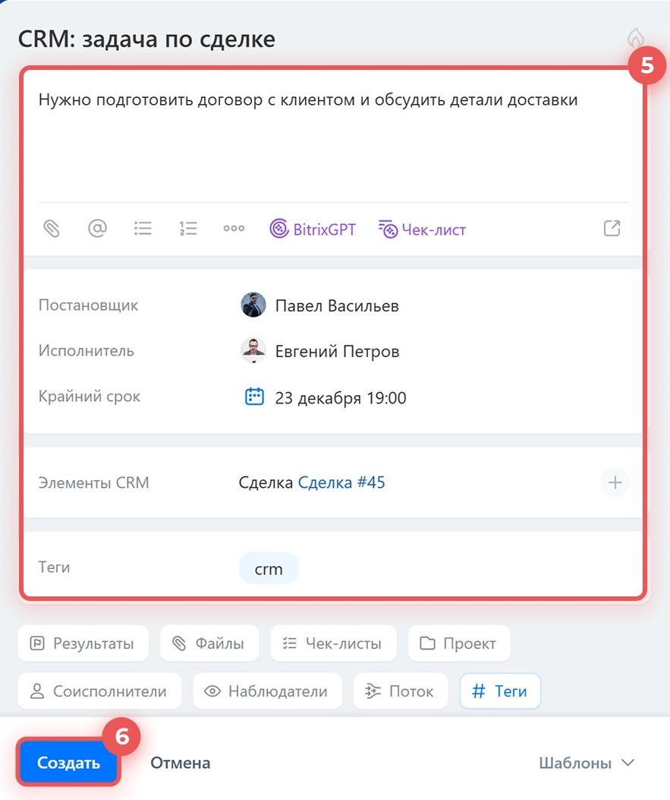
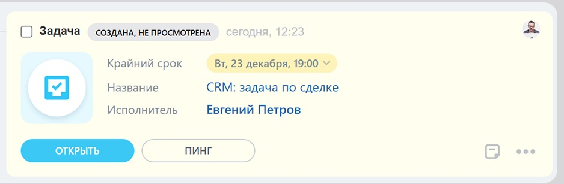

# Урок 6. Задача по сделке от постановки до завершения

В уроке 5 вы нашли заказ для Маяка. Теперь создадите по нему задачу вручную, запишете результат и завершите её. Работайте в своём Битрикс24 в браузере на компьютере.

## 1. Откройте сделку

1. Нажмите **CRM → Сделки → Список**.
2. Если в строке поиска остался фильтр из урока 5, снимите его крестиком **×** справа.
3. Введите **Маяка**, нажмите **Enter** и откройте сделку **«Учебный заказ — мебель для Маяка»** двойным щелчком.
4. Если карточки нет, очистите поиск, нажмите **«Создать»**, введите название из шага 3, сохраните и откройте новую сделку.

**Проверьте себя.** Открыта карточка заказа для Маяка. Справа видна лента событий — **таймлайн**.

## 2. Создайте задачу

1. Над лентой справа нажмите **«Задача»**. Если пункт не виден, раскройте **«Ещё»** в том же ряду.

2. В поле названия введите **«Проверить наличие мебели для Маяка»**.
3. В описание впишите **«Проверить учебную заявку и записать результат проверки в задаче»**.
4. В поле **«Исполнитель»** выберите себя. Если ваше имя уже стоит в поле, оставьте его.
5. В поле **«Крайний срок»** выберите завтрашний день и время **16:00**. Крайний срок — дата и время, к которым нужно выполнить задачу.
6. Если видно поле **«Элементы CRM»**, проверьте, что там указан заказ для Маяка. Связь со сделкой добавляется при создании задачи из её карточки.
7. Нажмите **«Создать»**. В официальной инструкции эта кнопка также называется **«Поставить задачу»**.

Имена, даты и названия на скриншотах приведены для примера. Используйте свои данные из шагов выше.

**Проверьте себя.** В таймлайне заказа появилась задача «Проверить наличие мебели для Маяка».

## 3. Запишите результат и завершите задачу

1. В таймлайне найдите созданную задачу и нажмите **«Открыть»**.

2. Проверьте исполнителя и крайний срок.
3. В комментарии или чате задачи напишите **«Учебная проверка выполнена. Мебель есть в наличии»** и отправьте запись внутри задачи. Это вымышленный результат для упражнения.
4. Нажмите **«Завершить»**. Если включён контроль постановщика и задача ждёт проверки, откройте её как постановщик и нажмите **«Принять»**.
5. Вернитесь в сделку. Если карточка была открыта в другой вкладке, обновите страницу. Найдите ту же задачу в таймлайне и проверьте её статус.

**Проверьте себя.** Задача завершена и связана с заказом для Маяка. Стадию сделки для этого упражнения менять не требуется.

**Что показать преподавателю** — задачу в таймлайне сделки и её карточку с исполнителем, сроком, результатом и статусом.

Скриншоты взяты из [официальной инструкции «Как работать с задачами в CRM»](https://helpdesk.bitrix24.ru/open/24212648/). Дополнительный материал — [как завершать задачи в Битрикс24](https://helpdesk.bitrix24.ru/open/27047638/).

[Назад к уроку 5](05-crm-search.md) · [Дальше — урок 7. Завершение сделки](07-close-deal.md) · [К оглавлению](README.md)
