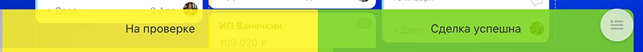
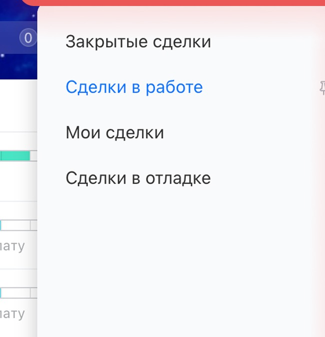

# Урок 7. Завершаем сделку и находим её в CRM

В уроке 6 вы завершили задачу по заказу для Маяка. Теперь отработаете завершение самой сделки. Задача показывает, выполнено ли отдельное действие. Финальная стадия сделки показывает итог продажи.

## 1. Подготовьте две учебные сделки

1. В своём Битрикс24 откройте **CRM → Сделки → Канбан**.
2. Снимите фильтр из прошлых уроков. Для этого нажмите **×** справа в строке **«Фильтр + поиск»**, если там есть активное условие.
3. Нажмите **«Создать»**. Введите название **«Урок 7 — кресло»** и нажмите **«Сохранить»**.
4. Ещё раз нажмите **«Создать»**. Введите название **«Урок 7 — стол»** и сохраните сделку в той же воронке.

**Проверьте себя.** На доске видны две новые карточки. Используйте их для упражнения. В сделке для Маяка остаётся результат урока 6.

## 2. Завершите продажу кресла успешно

По условию клиент получил кресло, и заказ выполнен.

1. Нажмите левой кнопкой мыши на карточку **«Урок 7 — кресло»** и удерживайте кнопку.
2. Потяните карточку вниз. Когда появятся зоны завершения, наведите карточку на зелёную зону **«Сделка успешна»** и отпустите кнопку. Если вместо зон на доске видна колонка успешного завершения, перетащите карточку туда.
3. Если Битрикс24 попросит подтвердить переход, прочитайте выбранный итог и подтвердите его.

*Фрагмент официального скриншота. [Как работать с канбаном](https://helpdesk.bitrix24.ru/open/21839648/).*

**Проверьте себя.** Кресло больше не находится в рабочей колонке. При включённом фильтре по открытым сделкам карточка может исчезнуть с доски. В разделе 4 вы найдёте её снова.

## 3. Зафиксируйте отказ от покупки стола

По условию клиент отменил заказ. Сначала запишите причину в карточке, затем завершите сделку.

1. Откройте **«Урок 7 — стол»**. Справа, в ленте событий, нажмите **«Комментарий»**.
2. Введите **«Учебный пример: клиент отменил заказ»** и сохраните комментарий.
3. Закройте карточку, чтобы вернуться на доску. Перетащите её в зону неуспешного завершения или в соответствующую финальную колонку. Её название зависит от воронки.
4. Если открылся выбор причины, выберите вариант, который соответствует отказу клиента. Если подходящей причины нет, используйте доступную общую стадию неуспешного завершения. Причина уже записана в комментарии.
5. Если зона завершения не появляется при перетаскивании, откройте карточку и посмотрите на шкалу стадий вверху. Нажмите **«Завершить сделку»**, если этот пункт виден, и выберите неуспешный итог.

**Проверьте себя.** Стол больше не находится в рабочей колонке, а причина отказа сохранена в карточке.

## 4. Найдите закрытые сделки и сравните итог

1. Над доской нажмите **«Список»**.
2. Щёлкните строку **«Фильтр + поиск»**. В левой части фильтра выберите **«Закрытые сделки»**. Если готового фильтра нет, добавьте поле **«Стадия сделки»** и выберите финальные стадии по очереди.
3. Найдите строки **«Урок 7 — кресло»** и **«Урок 7 — стол»**. Если записей много, откройте нужную по названию через поиск, как в уроке 5.
4. Откройте каждую карточку и проверьте итог на шкале стадий. У кресла должен быть успешный итог, у стола — неуспешный. В карточке стола найдите комментарий об отмене.

*Фрагмент официального скриншота. [Как работать со списком и фильтрами](https://helpdesk.bitrix24.ru/open/27405366/).*

**Что показать преподавателю** — обе закрытые карточки с разными итогами и комментарий о причине отказа в сделке со столом.

[Назад к уроку 6](06-crm-task.md) · [К оглавлению](README.md)
