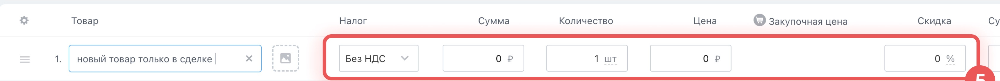

# Урок 8. Добавляем товар в сделку

Клиент из студии «Маяк» заказал два кресла. Создайте для этого заказа новую сделку. Она останется открытой и понадобится в уроке 9.

## 1. Откройте новую сделку

1. В браузере откройте свой Битрикс24.
2. Перейдите в **CRM → Сделки**.
3. Нажмите **«Создать»** над списком или доской.
4. Введите название **«Урок 8 — кресла для Маяка»**.
5. Нажмите **«Сохранить»**. Если карточка закрылась, найдите сделку по словам **«Урок 8»** в строке **«Фильтр + поиск»** и откройте её.

**Проверьте себя.** Вверху карточки написано «Урок 8 — кресла для Маяка».

## 2. Добавьте позицию

**Товарная позиция** — строка в заказе с названием товара, ценой за единицу и количеством. **Каталог** — список товаров, которые можно повторно выбирать в других сделках.

1. В верхнем ряду вкладок карточки нажмите **«Товары»**. Если вкладки не видно, раскройте **«Ещё»** в этом ряду. Если вкладка скрыта, откройте **«Ещё → Настроить меню»** и включите её, если у вас есть доступ к настройке.
2. Слева под вкладками нажмите синюю кнопку **«Добавить товар»**. В таблице появится новая строка.

3. В столбце **«Товар»** введите **«Учебное офисное кресло»**.
4. Если выпадающий список уже показывает товар с таким названием, выберите его. Если товара нет и Битрикс24 позволяет оставить новую позицию в сделке, перейдите к цене. Если требуется сохранить товар в каталоге, нажмите **«Создать»** в выпадающем списке, заполните форму учебным названием и ценой и сохраните товар.

**Проверьте себя.** В таблице есть одна строка с учебным креслом.

## 3. Заполните цену и количество

1. В этой строке щёлкните ячейку в столбце **«Количество»** и введите **2**.
2. В столбце **«Цена»** введите **12000**. Цена указывается за одно кресло. Если поля не помещаются, прокрутите таблицу по горизонтали.
3. Для этого примера выберите **«Без НДС»** в столбце **«Налог»**, если он виден. Скидку оставьте нулевой.

4. Нажмите **«Сохранить»** под таблицей.
5. Закройте карточку и откройте её снова. Перейдите на вкладку **«Товары»** и проверьте строку.

**Что показать преподавателю** — вкладку «Товары» в сделке «Урок 8 — кресла для Маяка». В строке видно два кресла по 12 000 ₽, сумма позиции составляет 24 000 ₽. Если общая сумма в карточке отличается, проверьте сумму строки во вкладке «Товары». Общая сумма зависит от режима расчёта сделки.

Скриншоты — фрагменты [официальной инструкции Битрикс24 по добавлению товаров](https://helpdesk.bitrix24.ru/open/27964692/).

[Назад к уроку 7](07-close-deal.md) · [Дальше — урок 9. Файл и важный комментарий](09-deal-handoff.md) · [К оглавлению](README.md)
