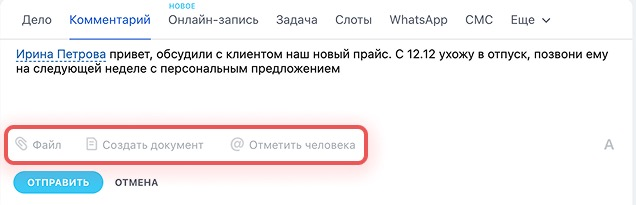
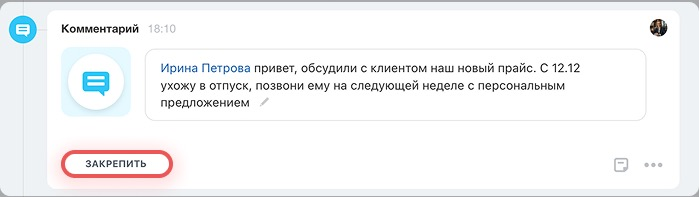

# Урок 9. Прикрепляем файл и закрепляем комментарий

Коллеге нужно открыть заказ для Маяка и сразу увидеть, что уточнить перед доставкой. Добавьте в карточку короткую заметку с файлом и закрепите её.

## 1. Сохраните учебный файл

1. Откройте [«Памятку по доставке Маяку»](examples/mayak-delivery.txt).
2. На странице файла на GitHub нажмите **«Download raw file»** (значок загрузки). Запомните папку, куда сохранился файл **mayak-delivery.txt**. Обычно это «Загрузки».
3. Если скачать файл не получилось, откройте текстовый редактор. Напишите «Перед доставкой двух учебных кресел уточнить время приёмки» и сохраните файл с именем **mayak-delivery.txt**.

**Проверьте себя.** Файл открывается с компьютера, и в нём только вымышленные данные.

## 2. Найдите карточку и добавьте комментарий

1. В своём Битрикс24 откройте **CRM → Сделки → Список**.
2. Если в строке **«Фильтр + поиск»** стоит старое условие, снимите его крестиком справа.
3. Введите **«Урок 8»** и нажмите **Enter**. Дважды щёлкните строку **«Урок 8 — кресла для Маяка»**. Если вы пропустили урок 8, создайте сделку с этим названием и откройте её.
4. Откройте вкладку **«Общие»** в карточке. Справа найдите **таймлайн** — ленту событий сделки.
5. В верхнем ряду таймлайна нажмите **«Комментарий»**. Если пункта не видно, раскройте **«Ещё»** в том же ряду.
6. Введите текст **«Перед доставкой уточнить время приёмки. Памятка для коллеги приложена»**.

## 3. Прикрепите файл и сохраните запись

1. Под текстом комментария нажмите **«Файл»** со значком скрепки.
2. Выберите загрузку с компьютера, если Битрикс24 предложит несколько источников.
3. В окне выбора откройте папку «Загрузки» или ту, куда сохранили файл. Выберите **mayak-delivery.txt** и нажмите **«Открыть»**.
4. Дождитесь, пока имя файла появится под комментарием. Нажмите **«Отправить»** в форме комментария. Запись появится в ленте сделки.

**Проверьте себя.** В ленте виден ваш комментарий. Щёлкните по имени вложения и убедитесь, что оно открывается или скачивается.

## 4. Закрепите комментарий

1. Найдите свой комментарий с вложением в ленте.
2. Нажмите **«Закрепить»** под комментарием. Закрепление поднимает запись вверх, чтобы её можно было быстро найти.

3. Закройте карточку и откройте её снова.
4. Посмотрите верхнюю часть ленты. Найдите закреплённый комментарий и проверьте, что вложение осталось доступно.

**Что показать преподавателю** — карточку заказа с закреплённым комментарием и файлом **mayak-delivery.txt**.

Скриншоты — фрагменты [официальной инструкции Битрикс24 по работе с таймлайном](https://helpdesk.bitrix24.ru/open/23960160/).

[Назад к уроку 8](08-deal-products.md) · [К оглавлению](README.md)
