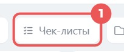
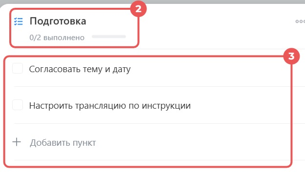

# Урок 10. Чек-лист перед доставкой

В уроке 6 вы поставили задачу и записали результат. Теперь разложите одну задачу на действия и отмечайте каждое после проверки. **Чек-лист** — список действий с галочкой напротив каждого пункта.

## 1. Откройте сделку и создайте задачу

1. Откройте **CRM → Сделки → Список**.
2. Если в строке поиска остался фильтр из прошлых уроков, снимите его крестиком справа.
3. Введите **«кресла для Маяка»** и откройте сделку **«Урок 8 — кресла для Маяка»**. Если её нет, нажмите **«Создать»**, введите это название, сохраните и откройте карточку.
4. На вкладке **«Общие»** справа, над лентой событий, нажмите **«Задача»**. Если пункта нет в ряду, раскройте **«Ещё»** в том же ряду.
5. Введите название **«Урок 10 — проверить заказ перед доставкой»**. В поле **«Исполнитель»** выберите себя.
6. Под полями задачи нажмите **«Чек-листы»**. Ищите эту кнопку в ряду рядом с **«Файлы»** и **«Проект»**.

## 2. Заполните чек-лист и сохраните задачу

1. В верхней строке чек-листа введите название **«Подготовка к доставке»**.
2. Введите первый пункт **«Сверить количество кресел»**.
3. Нажмите **«Добавить пункт»** и введите **«Проверить памятку в карточке»**.
4. Ещё раз нажмите **«Добавить пункт»** и введите **«Записать, что нужно уточнить перед доставкой»**.

5. Нажмите **«Сохранить»** в редакторе чек-листа.

6. В форме задачи нажмите **«Создать»** или **«Поставить задачу»**. Вернитесь в сделку и откройте задачу из ленты событий.

**Проверьте себя.** В карточке задачи есть чек-лист «Подготовка к доставке» с тремя отдельными пунктами.

## 3. Проверьте заказ и отметьте пункты

1. В сделке откройте вкладку **«Товары»** и проверьте, что указано два кресла. Если вы начали с этого урока, возьмите количество из [учебной памятки](examples/mayak-delivery.txt). Вернитесь в задачу и поставьте галочку у первого пункта.
2. Проверьте памятку в ленте сделки или откройте тот же учебный файл по ссылке. Отметьте второй пункт.
3. В комментарии к задаче напишите **«Перед доставкой нужно уточнить время приёмки»**. Отправьте комментарий и отметьте третий пункт.
4. Откройте задачу снова и убедитесь, что все три галочки сохранились.

**Что показать преподавателю** — карточку задачи с тремя выполненными пунктами и записью о времени приёмки.

Скриншоты — фрагменты [официальной инструкции по чек-листам Битрикс24](https://helpdesk.bitrix24.ru/open/27333140/).

[Назад к уроку 9](09-deal-handoff.md) · [Дальше — урок 11. Восстановление сделки](11-crm-recycle-bin.md) · [К оглавлению](README.md)
