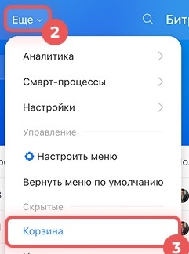
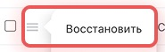

# Урок 11. Восстанавливаем учебную сделку из корзины

Представьте, что менеджер случайно удалил карточку заказа. Потренируйтесь искать удалённую запись и возвращать её в CRM на специально созданной пустой сделке.

## 1. Проверьте доступ и создайте пробную сделку

1. Откройте **CRM → Ещё → Корзина**. Кнопка **«Ещё»** находится в верхнем меню CRM.

2. Если корзина недоступна или вы не уверены, что ваш тариф позволяет восстанавливать сделки, воспользуйтесь учебным разбором в конце урока. Восстановление доступно не на всех тарифах.
3. Перейдите в **CRM → Сделки → Список**.
4. Нажмите **«Создать»** и введите **«Урок 11 — пробная сделка для восстановления»**. Сохраните её. Оставьте клиентские поля и связанные записи пустыми.
5. В строке поиска введите **«пробная сделка для восстановления»** и найдите созданную карточку.

**Проверьте себя.** В списке видна ваша новая пробная сделка.

## 2. Переместите пробную сделку в корзину

1. В списке найдите кнопку **≡** слева от названия пробной сделки. Она открывает меню действий для этой строки.
2. Проверьте название ещё раз. Выберите **«Удалить»** только у сделки, созданной в этом уроке.
3. Если открылось окно подтверждения, убедитесь, что операция относится к одной пробной сделке, и подтвердите.
4. Проверьте, что пробная сделка исчезла из списка.

[Официальная инструкция по действиям со сделками в списке](https://helpdesk.bitrix24.ru/open/27405366/)

## 3. Верните сделку

1. Снова откройте **CRM → Ещё → Корзина**.
2. Найдите строку **«Урок 11 — пробная сделка для восстановления»**. Если строк много, откройте фильтр, выберите тип **«Сделка»** и сегодняшний день в поле времени удаления.
3. Нажмите **≡** слева в строке пробной сделки. В меню выберите **«Восстановить»**.

4. Дождитесь уведомления о восстановлении.
5. Перейдите в **CRM → Сделки → Список**. Снимите старые условия фильтра и снова найдите сделку по названию. У восстановленной карточки может быть новый номер, поэтому открывайте её из списка.

**Что показать преподавателю** — восстановленную сделку, открытую из списка CRM.

**Учебный разбор, если восстановление недоступно.** По двум скриншотам покажите, где открыть корзину и где нажать «Восстановить». Объясните, как отличить пробную сделку от других записей. Удаление для этого варианта пропустите.

Скриншоты — фрагменты [официальной инструкции о корзине CRM](https://helpdesk.bitrix24.ru/open/24668648/).

[Назад к уроку 10](10-task-checklist.md) · [Дальше — урок 12. Дубликаты контактов](12-crm-duplicates.md) · [К оглавлению](README.md)
