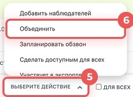
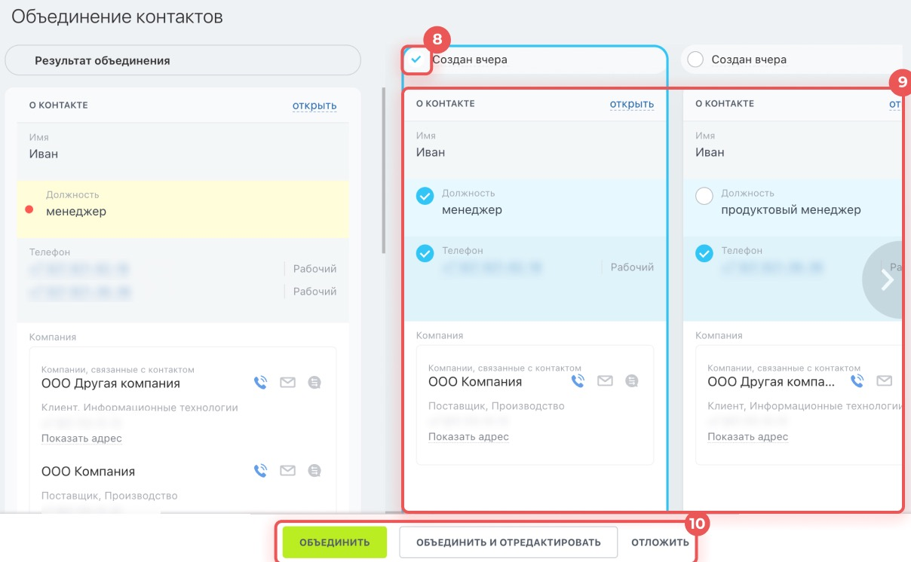

# Урок 12. Объединяем дубликаты контакта

Одного клиента внесли в CRM дважды. В одной карточке есть должность, в другой — почта. **Дубликат** — повторная запись о том же человеке или компании. В этом уроке выберите, какие сведения сохранить в общей карточке.

## 1. Создайте две пробные карточки

1. На своём учебном портале откройте **CRM → Клиенты → Контакты**.
2. Нажмите **«Создать»**. Укажите имя **«Алина»**, фамилию **«Дубль-12»**, должность **«Менеджер»**. Сохраните контакт.
3. Снова нажмите **«Создать»**. Укажите имя **«Алина»**, фамилию **«Дубль-12»**, электронную почту **alina12@example.com**. Должность оставьте пустой. Сохраните контакт.
4. Если поля «Должность» или «E-mail» не видно, в карточке нажмите **«Выбрать поле»** и добавьте нужное. Если CRM покажет совпадение при создании второго контакта, проверьте, предлагает ли она сохранить новую карточку. Если сохранить её нельзя, выполните разбор по скриншоту в конце урока.
5. Вернитесь к списку контактов. В поиске введите **«Дубль-12»**.

**Проверьте себя.** Видны две учебные карточки с одинаковым именем. Откройте их по очереди и проверьте, в какой указана должность, а в какой почта.

## 2. Откройте предварительный просмотр

1. В списке поставьте галочки **слева от двух учебных карточек**. Проверьте, что выбраны только они.
2. В нижней панели нажмите **«Выберите действие» → «Объединить»**.
3. Нажмите **«Применить»**. Откроется окно сравнения карточек.

Если пункта «Объединить» нет, проверьте, что отмечены обе строки. Для объединения нужны права на изменение и удаление контактов. При отсутствии этих прав выполните разбор по скриншоту.

## 3. Выберите данные и сохраните результат

1. Вверху одной из колонок отметьте **основную карточку** — ту, которая должна остаться в CRM. Для упражнения выберите карточку с должностью «Менеджер».
2. Проверьте значения в обеих колонках. Выберите должность **«Менеджер»** и почту **alina12@example.com**, если они ещё не выбраны.
3. В левой колонке **«Результат объединения»** проверьте, что в итоговой карточке будут и должность, и почта.

4. Нажмите **«Объединить и отредактировать»**. Если выбрали **«Объединить»**, вернитесь в список и откройте оставшийся контакт по фамилии.
5. Проверьте должность и почту. Снова выполните поиск по слову **«Дубль-12»** и убедитесь, что осталась одна карточка.

**Что показать преподавателю** — один учебный контакт с должностью и электронной почтой.

**Учебный разбор по скриншоту.** Покажите, где выбирается основная карточка и где виден будущий результат. Объясните, какие поля вы бы сохранили из каждой записи. Объединение изменяет базу, поэтому для практики используйте только специально созданную пару.

Скриншоты — фрагменты [официальной инструкции по объединению дубликатов Битрикс24](https://helpdesk.bitrix24.ru/open/25343258/).

[Назад к уроку 11](11-crm-recycle-bin.md) · [Дальше — урок 13. Личная доска задач](13-my-plan.md) · [К оглавлению](README.md)
