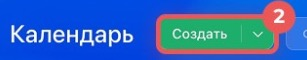
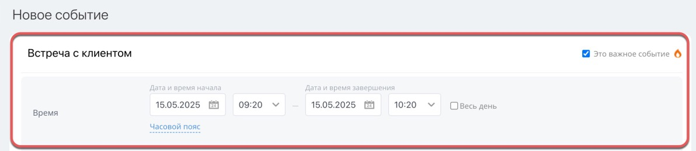
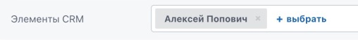

# Урок 14. Планируем встречу в календаре

В уроке 13 вы записали, что нужно уточнить время приёмки. Теперь выделите в своём календаре время на учебное обсуждение доставки и настройте напоминание. **Событие** — запись в календаре с временем начала и окончания.

## 1. Откройте форму события

1. В левом меню своего Битрикс24 нажмите **«Календарь»**.
2. Вверху рядом с заголовком **«Календарь»** нажмите зелёную кнопку **«Создать»**.

## 2. Укажите время и напоминание

1. В поле названия напишите **«Урок 14 — обсудить доставку Маяку»**.
2. Укажите завтрашнюю дату. Выберите свободный интервал, например **15:00–15:30**. Даты и время на скриншоте показаны для примера.
3. Если стоит галочка **«Весь день»**, снимите её, чтобы задать время начала и окончания.

4. В поле **«Календарь»** оставьте свой календарь. Для учебного события достаточно вашего участия.
5. Прокрутите форму вниз и раскройте **«Дополнительно»**. В поле **«Описание»** напишите **«Уточнить удобное время приёмки двух кресел»**.
6. В строке **«Напоминание»** нажмите **«Добавить»**, если напоминания ещё нет. Выберите напоминание за 15 минут. Если уже стоит другое время, откройте его и измените либо оставьте доступный вариант.
7. Нажмите **«Сохранить»** внизу формы.

**Проверьте себя.** Откройте завтрашний день в календаре. Щёлкните событие и проверьте название, интервал и описание.

## 3. Свяжите событие со сделкой, если поле доступно

1. Откройте событие и нажмите **«Редактировать»**.
2. Раскройте **«Дополнительно»**. В строке **«Элементы CRM»** нажмите **«+ выбрать»**.

3. Найдите сделку **«Урок 8 — кресла для Маяка»**, выберите её и нажмите **«Сохранить»**. Если поля или сделки нет, оставьте название заказа в описании события.

**Что показать преподавателю** — событие в календаре с учебным названием, временем и описанием. Если сделку удалось связать, покажите её в форме события.

Скриншоты — фрагменты [официальной инструкции по созданию события](https://helpdesk.bitrix24.ru/open/25489764/).

[Назад к уроку 13](13-my-plan.md) · [Дальше — урок 15. Мой диск](15-my-drive.md) · [К оглавлению](README.md)
