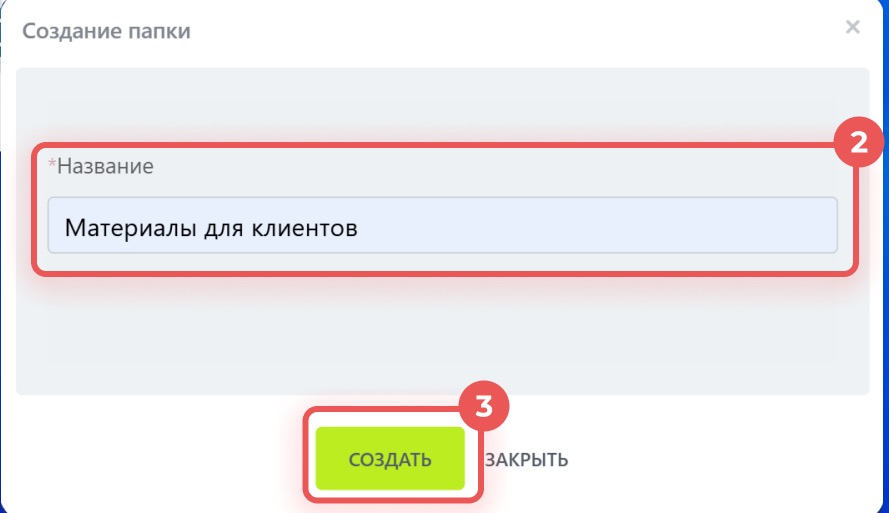

# Урок 15. Папка с материалами заказа на Диске

Соберите учебные файлы заказа в одном месте. **«Мой диск»** — личное место для файлов внутри Битрикс24. Папка поможет найти памятку позже и отличить её от документов других заказов.

## 1. Подготовьте памятку

1. Если файл **mayak-delivery.txt** из урока 9 уже есть на компьютере, найдите его в папке «Загрузки».
2. Если файла нет, откройте [учебную памятку](examples/mayak-delivery.txt). На странице GitHub нажмите значок загрузки **«Download raw file»**. Запомните, куда сохранился файл.
3. Если скачать файл не получилось, создайте в текстовом редакторе файл **mayak-delivery.txt** с текстом «Перед доставкой двух учебных кресел уточнить время приёмки».

**Проверьте себя.** Файл открывается на вашем компьютере.

## 2. Создайте папку

1. В левом меню Битрикс24 нажмите **«Диск»**.
2. В верхнем меню нажмите **«Диск» → «Мой диск»**. Проверьте заголовок страницы.
3. Нажмите зелёную кнопку **«Добавить»** и в списке выберите **«Папка»**.

4. Введите **«Урок 15 — заказ для Маяка»** и нажмите **«Создать»**. Если папка с таким именем уже есть, откройте её.

**Проверьте себя.** Папка появилась на странице «Мой диск». На скриншоте из справки может быть открыт другой диск. Для упражнения работайте на странице «Мой диск».

## 3. Загрузите и найдите файл

1. Откройте папку **«Урок 15 — заказ для Маяка»**.
2. Внутри неё нажмите **«Добавить» → «Файл»**.
3. В окне выбора перейдите в папку, где лежит **mayak-delivery.txt**. Выберите файл и нажмите **«Открыть»**.
4. Дождитесь окончания загрузки. Если появится окно с результатом, нажмите **«Закрыть»**, чтобы вернуться к папке.
5. Выйдите из папки на страницу «Мой диск», затем откройте её снова. Убедитесь, что памятка осталась внутри. Если вместо просмотра файла браузер предлагает скачать его, откройте скачанную копию.

**Что показать преподавателю** — папку на странице «Мой диск» и файл **mayak-delivery.txt** внутри неё.

Скриншоты — фрагменты [официальной инструкции по папкам и файлам на Диске](https://helpdesk.bitrix24.ru/open/28166604/).

[Назад к уроку 14](14-calendar.md) · [Дальше — урок 16. Версии файлов](16-drive-versions.md) · [К оглавлению](README.md)
