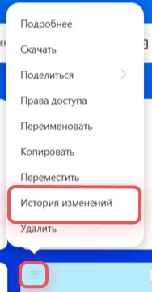
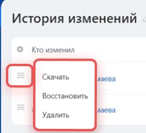

# Урок 16. Обновляем памятку и проверяем версии файла

В уроке 15 вы сохранили памятку на Диске. Теперь представьте, что время приёмки согласовано. Обновите учебный файл и проверьте, сохранился ли прежний текст. **Версия файла** — его содержимое на момент сохранения.

## 1. Подготовьте новую редакцию

1. Откройте [учебную памятку](examples/mayak-delivery.txt). На странице GitHub нажмите кнопку загрузки **«Download raw file»**.
2. Откройте скачанный файл в текстовом редакторе.
3. Замените строку о том, что время приёмки нужно уточнить, на **«Учебное время приёмки согласовано: с 15:00 до 17:00»**.
4. Сохраните изменённый текст отдельным файлом **mayak-delivery-v2.txt**. Если кнопки «Сохранить как» нет, создайте новый текстовый файл, скопируйте в него изменённый текст и сохраните под этим именем.

**Проверьте себя.** На компьютере есть исходная и обновлённая памятки, и их последние строки различаются.

## 2. Обновите файл на Диске

1. В Битрикс24 откройте **«Диск» → «Мой диск»**.
2. Откройте папку **«Урок 15 — заказ для Маяка»**. Если её нет, создайте её через **«Добавить» → «Папка»**.
3. Найдите **mayak-delivery.txt**. Если его нет, загрузите исходную памятку через **«Добавить» → «Файл»**.
4. Откройте меню **≡** именно у файла **mayak-delivery.txt**. Если есть команда **«Загрузить новую версию»**, выберите её, укажите **mayak-delivery-v2.txt** и подтвердите загрузку.
5. Если команды нет, загрузите **mayak-delivery-v2.txt** рядом с исходным файлом через **«Добавить» → «Файл»**. Оставьте обе редакции в папке. Это вариант для портала, где встроенное управление версиями недоступно.

[Официальная инструкция по действиям с файлами на Диске](https://helpdesk.bitrix24.ru/open/28166604/)

## 3. Проверьте старый и новый текст

1. Если загрузили новую версию через меню файла, снова откройте меню **≡** и выберите **«История изменений»**.

2. Найдите предыдущую редакцию по дате. Нажмите **≡** рядом с ней и выберите **«Скачать»**. Откройте скачанную копию и найдите строку о том, что время ещё нужно уточнить.

3. Вернитесь в папку и откройте или скачайте текущую памятку. Проверьте строку о согласованном времени.
4. Если на вашем тарифе история версий недоступна, сравните два отдельных файла в папке. В исходном файле время ещё уточняется, в обновлённом уже указан интервал.

**Что показать преподавателю** — старый и новый текст памятки. Если доступна история, покажите, где скачали предыдущую версию.

Скриншоты — фрагменты [официальной справки об истории версий](https://helpdesk.bitrix24.ru/open/18869612/).

[Назад к уроку 15](15-my-drive.md) · [Дальше — урок 17. Заметки](17-messenger-notes.md) · [К оглавлению](README.md)
