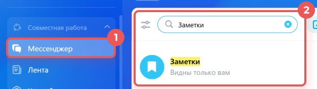

# Урок 17. Личные заметки в мессенджере

Сохраните для себя короткую запись об изменении заказа. Затем найдите её среди других сообщений по ключевому слову. **«Заметки»** — личный чат, который виден только вам.

## 1. Найдите личный чат

1. В левом меню своего Битрикс24 нажмите **«Мессенджер»**. Если раздел сгруппирован, откройте **«Совместная работа» → «Мессенджер»**.
2. В строке поиска **над списком чатов** введите **«Заметки»**.
3. Щёлкните результат **«Заметки»** с подписью **«Видны только вам»**. Если результат не появился, попробуйте найти чат по своей фамилии.

**Проверьте себя.** Вверху открытого чата написано «Заметки».

## 2. Добавьте две учебные записи

1. Щёлкните поле ввода внизу чата.
2. Введите **«Маяк: время приёмки согласовано. Актуальная памятка лежит на Моём диске»** и нажмите кнопку отправки справа.
3. Отдельным сообщением напишите **«Перед следующей встречей открыть календарь и проверить время»**. Отправьте его в тот же чат.

**Проверьте себя.** В чате видны две разные записи.

## 3. Найдите первую запись внутри чата

1. В правом верхнем углу **открытого чата** нажмите значок **лупы**. Это поиск по сообщениям в «Заметках».
2. В открывшейся справа панели введите **«приёмки»**. Если совпадений несколько, найдите сообщение, которое начинается со слова «Маяк».
3. Щёлкните по найденному фрагменту. Мессенджер перейдёт к сообщению в чате.

**Проверьте себя.** По слову «приёмки» найдено первое сообщение. Затем введите **«календарь»** и найдите второе.

**Что показать преподавателю** — чат «Заметки» и результат поиска записи о Маяке.

Скриншоты — фрагменты [официальной инструкции «Что такое Заметки»](https://helpdesk.bitrix24.ru/open/25210192/).

[Назад к уроку 16](16-drive-versions.md) · [К оглавлению](README.md)
