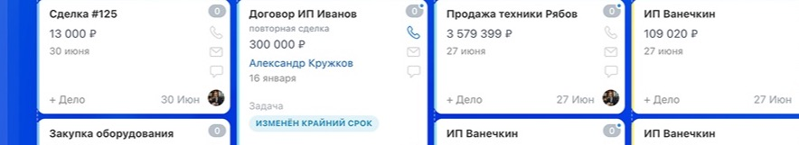
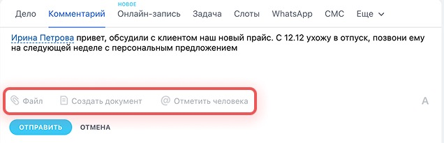
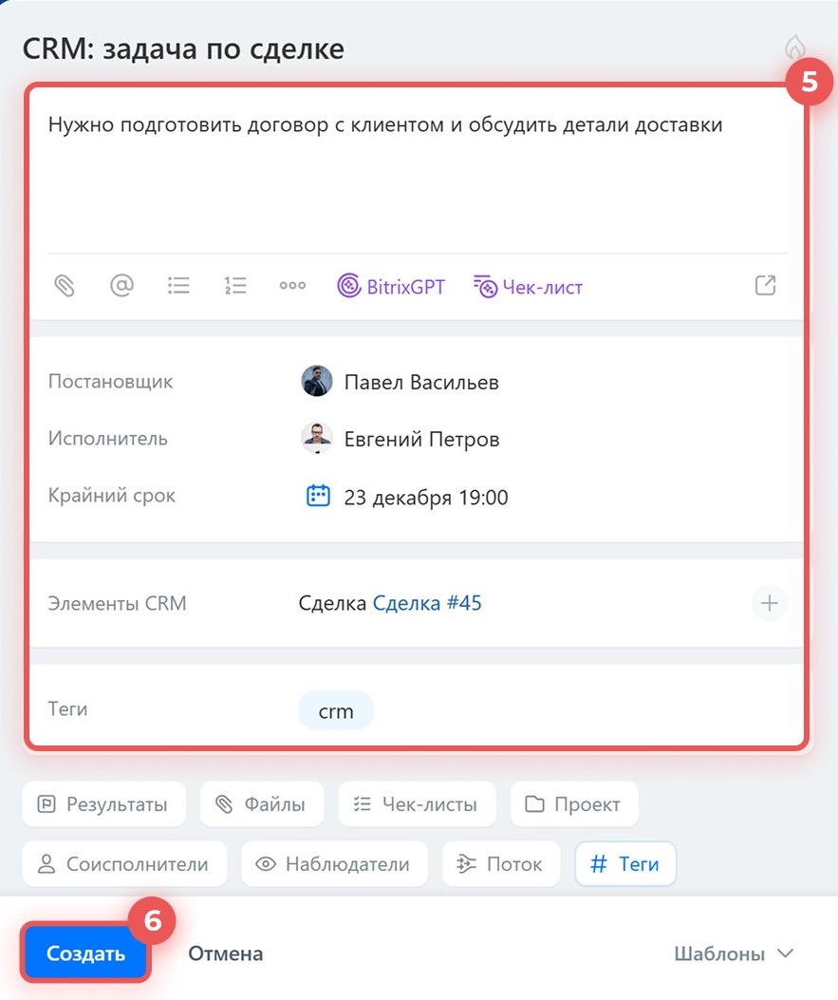
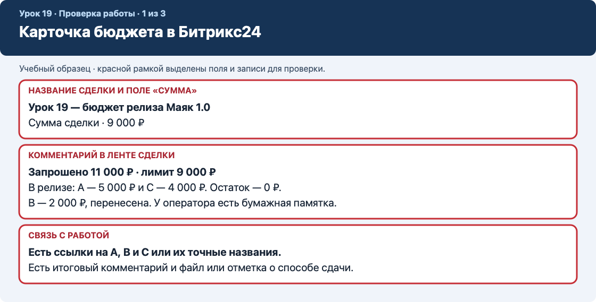
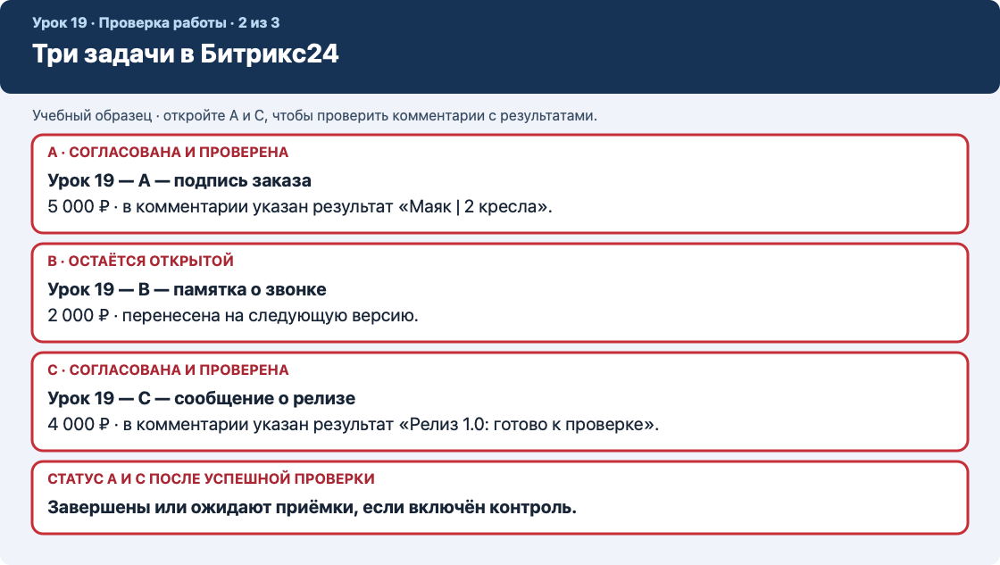
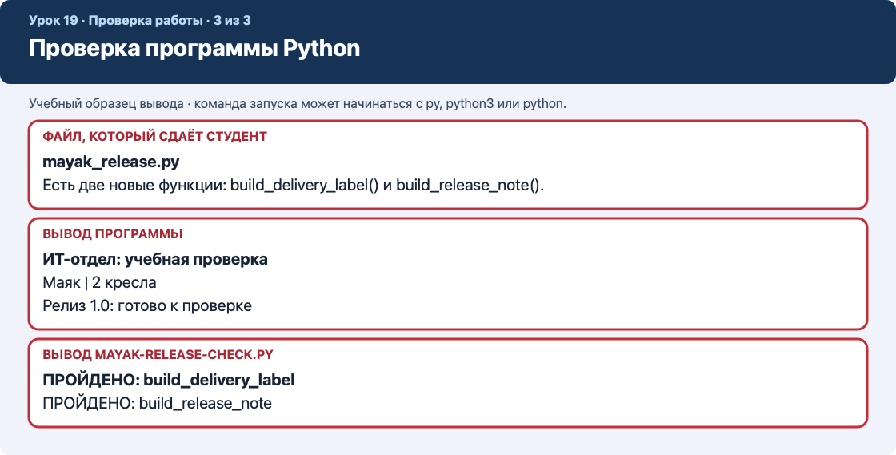

# Урок 19. Стажировка в ИТ-отделе — заявки, бюджет и релиз Python

Это учебная имитация корпоративного проекта. Все названия, суммы и решения относятся к вымышленному заказу. Работайте в веб-версии Битрикс24 и в редакторе кода на компьютере.

## Служебная записка от руководителя

Отдел доставки готовит внутреннюю утилиту. Сотрудники вручную подписывают заказы и пересказывают состояние релиза в чатах. Попросили сделать три небольшие функции. Денег на все доработки в этом цикле нет.

Вы — стажёр ИТ-отдела. Сначала оформите входящие заявки, затем соберите бюджет первой версии. После согласования напишите только утверждённые функции, проверьте их и передайте результат на приёмку.

### Карточки требований

- **A — подпись заказа, 5 000 ₽.** Сотрудник склада должен увидеть «Маяк | 2 кресла».
- **B — памятка о звонке, 2 000 ₽.** Оператору нужна строка «Позвонить перед выездом». У оператора пока есть бумажная памятка.
- **C — сообщение о релизе, 4 000 ₽.** Проверяющему нужна строка «Релиз 1.0: готово к проверке».

### Условия согласования

- Лимит первой версии — **9 000 ₽**.
- Склад выпускает заказ только с подписью, поэтому **A обязательна**.
- Руководитель требует передавать работу на проверку с сообщением о релизе, поэтому **C обязательна**.
- **B** можно перенести на следующую версию.
- Записи о бюджете ведём в учебной сделке. Запросы A, B и C оформляем отдельными задачами. Ссылки на задачи добавляем в комментарий сделки.
- Для упражнения нужны обычные сделки и задачи. Оплату, счета, отправку сообщений клиентам и роботов не настраиваем.

### Роли

При работе в одиночку назначайте исполнителем себя. Решение о бюджете и приёмку оформляйте как учебные записи с указанием роли. В паре можно обменяться результатами и попросить коллегу проверить вывод программы.

### Подсказки DeepSeek

Если застряли, воспользуйтесь подсказкой под нужным шагом. Отправляйте только вымышленные данные, короткий фрагмент учебного кода и текст ошибки без имени пользователя, адреса портала, токенов и рабочих файлов. Просите подсказать следующий шаг, затем самостоятельно проверьте ответ.

### Где лежат файлы и что сдавать

- **GitHub, папка `examples`.** Скачайте [`mayak-release-starter.py` — заготовку программы](examples/mayak-release-starter.py) и [`mayak-release-check.py` — скрипт проверки](examples/mayak-release-check.py).
- **Ваш компьютер, папка `lesson19-mayak`.** Сделайте копию заготовки под именем `mayak_release.py`. Пишите код в этой копии, а проверяющий скрипт оставьте рядом. Вывод обеих команд будет виден в терминале VS Code.
- **Битрикс24.** Здесь хранятся карточка бюджета, три задачи и комментарии с результатами. К итоговому комментарию в сделке приложите `mayak_release.py`, если загрузка доступна. Иначе сдайте этот файл отдельно преподавателю и запишите в комментарии, как его передали. Публиковать свою работу на GitHub для этого задания не требуется.

Изображения ниже — фрагменты официальной справки. Подписи на них относятся к примерам авторов справки. Для урока вводите значения из этой инструкции.

## 1. Разберите входящие заявки

### Шаг 1.1. Прочитайте запрос склада

Найдите заявку A в записке. Выпишите, кому нужна подпись и где её будут читать.

**На экране или в записи**

Склад читает подпись заказа. В подписи нужны название клиента и количество кресел.

**Если застряли.** Можно спросить DeepSeek: «Чем потребность пользователя отличается от способа её реализации?»

### Шаг 1.2. Разберите запрос оператора

Найдите заявку B. Запишите, что хочет оператор и какая замена уже есть.

**На экране или в записи**

Запрос понятен, но оператор может пользоваться бумажной памяткой до следующего выпуска.

**Если застряли.** Можно спросить DeepSeek: «Почему запрос может быть полезен, но не обязателен для первого выпуска?»

### Шаг 1.3. Разберите запрос проверяющего

Найдите заявку C. Выпишите, какой текст увидит проверяющий.

**На экране или в записи**

Результат можно сравнить с точной строкой из служебной записки.

**Если застряли.** Можно спросить DeepSeek: «Как сделать результат функции проверяемым одним сравнением?»

### Шаг 1.4. Посчитайте стоимость всех заявок

Сложите 5 000, 2 000 и 4 000. Сравните сумму с лимитом.

**На экране или в записи**

Все заявки стоят 11 000 ₽. Лимит 9 000 ₽.

**Если застряли.** Можно спросить DeepSeek: «Покажи, как проверить, превышает ли сумма трёх заявок лимит.»

### Шаг 1.5. Выберите состав первой версии

Отметьте A и C как обязательные. Вычислите их сумму и остаток лимита.

**На экране или в записи**

A и C стоят 9 000 ₽. Остаток лимита равен 0 ₽. B перенесена.

**Если застряли.** Можно спросить DeepSeek: «Почему при выборе между обязательной и необязательной работой одной цены недостаточно?»


## 2. Создайте запись о бюджете в CRM

### Шаг 2.1. Откройте раздел сделок

В левом меню нажмите **CRM**, затем в верхнем меню CRM нажмите **«Сделки»**.

**На экране или в записи**

Открылась доска или список сделок.

**Если застряли.** Можно спросить DeepSeek: «Где в веб-версии Битрикс24 находится раздел «Сделки»?»

### Шаг 2.2. Откройте форму новой сделки

Над доской или списком нажмите **«Создать»**. Если кнопка разделена на две части, нажмите надпись слева от стрелки.

**На экране или в записи**

Открыта карточка новой сделки.



**Если застряли.** Можно спросить DeepSeek: «Как по скриншоту отличить кнопку создания сделки от меню рядом?»

### Шаг 2.3. Запишите название

Щёлкните поле **«Название»** и введите **«Урок 19 — бюджет релиза Маяк 1.0»**.

**На экране или в записи**

По названию понятно, что это отдельная учебная запись о бюджете.

**Если застряли.** Можно спросить DeepSeek: «Почему для бюджета этого урока полезна отдельная карточка?»

### Шаг 2.4. Укажите согласованную сумму

В поле **«Сумма»** введите **9000**. Если рядом можно выбрать валюту, укажите рубли. Оставьте товары и клиентские контакты пустыми.

**На экране или в записи**

В поле записана согласованная сумма. Стоимость всех заявок появится отдельно в комментарии.

**Если застряли.** Можно спросить DeepSeek: «Где в карточке сделки искать сумму и валюту?»

### Шаг 2.5. Сохраните и найдите карточку

Нажмите **«Сохранить»**. Если карточка закрылась, в списке сделок снимите старый фильтр и найдите её по словам **«бюджет релиза Маяк»**.

**На экране или в записи**

Открыта только что созданная сделка с нужным названием.

**Если застряли.** Можно спросить DeepSeek: «Что проверить, если созданную сделку не видно в списке?»

### Шаг 2.6. Проверьте сумму после сохранения

Посмотрите блок с данными о сделке. Если сумма не сохранилась, откройте редактирование поля суммы, внесите значение и сохраните ещё раз.

**На экране или в записи**

Сумма читается как 9 000 в выбранной валюте.

**Если застряли.** Можно спросить DeepSeek: «Как проверить, сохранилось ли поле карточки после закрытия формы?»

### Шаг 2.7. Зафиксируйте расчёт

На вкладке **«Общие»** справа в ленте событий нажмите **«Комментарий»**. Введите: **«Запрошено 11 000 ₽. Лимит 9 000 ₽. Согласованы A — 5 000 ₽ и C — 4 000 ₽. B — 2 000 ₽, следующая версия. Остаток лимита 0 ₽.»** Нажмите **«Отправить»**.

**На экране или в записи**

В ленте сделки виден расчёт.



**Если застряли.** Можно спросить DeepSeek: «Почему в комментарии полезно хранить и лимит, и причины переноса?»


## 3. Зарегистрируйте три заявки

### Шаг 3.1. Откройте раздел задач

В левом меню нажмите **«Задачи»** или **«Задачи и проекты» → «Задачи»**. Над списком нажмите **«Создать»**.

**На экране или в записи**

Открыта форма задачи.

**Если застряли.** Можно спросить DeepSeek: «Как найти раздел задач в веб-версии Битрикс24?»

### Шаг 3.2. Подготовьте форму

Если открылась короткая форма, нажмите **«Полная форма»** внизу справа. Найдите поля названия, описания, исполнителя и срока.

**На экране или в записи**

Форма готова к заполнению.


**Если застряли.** Можно спросить DeepSeek: «Какие поля задачи нужны для понятного поручения стажёру?»

### Шаг 3.3. Оформите заявку A

Название — **«Урок 19 — A — подпись заказа»**. В описание внесите: **«Склад. Оценка 5 000 ₽. Согласовано в релиз 1.0. Реализовать build_delivery_label() без параметров. Вернуть строку: Маяк | 2 кресла.»**

**На экране или в записи**

В описании A есть пользователь, стоимость и ожидаемый результат.



**Если застряли.** Можно спросить DeepSeek: «Как переписать требование к функции так, чтобы результат можно было проверить?»

### Шаг 3.4. Назначьте исполнителя A

В поле **«Исполнитель»** выберите себя. В поле **«Крайний срок»** укажите срок сдачи, названный преподавателем. Если его нет, выберите завтра, 18:00. Нажмите **«Создать»**.

**На экране или в записи**

Заявка A видна в списке. Откройте её и проверьте исполнителя и срок.

**Если застряли.** Можно спросить DeepSeek: «Чем исполнитель задачи отличается от постановщика?»

### Шаг 3.5. Оформите заявку B

Создайте ещё одну задачу. Название — **«Урок 19 — B — памятка о звонке»**. Описание — **«Оператор. Оценка 2 000 ₽. Перенесено на следующую версию: у оператора есть бумажная памятка. Результат будущей функции: Позвонить перед выездом.»** Выберите себя и сохраните. Срок не задавайте, если форма это позволяет.

**На экране или в записи**

B зарегистрирована и остаётся открытой. Если форма требует срок, укажите дату пересмотра, а в описании назовите её именно датой пересмотра.

**Если застряли.** Можно спросить DeepSeek: «Как объяснить разницу между запланированной работой и запросом на будущее?»

### Шаг 3.6. Оформите заявку C

Создайте задачу **«Урок 19 — C — сообщение о релизе»**. Описание — **«Проверяющий. Оценка 4 000 ₽. Согласовано в релиз 1.0. Реализовать build_release_note() без параметров. Вернуть строку: Релиз 1.0: готово к проверке.»** Назначьте себя и поставьте тот же срок, что у A.

**На экране или в записи**

Заявка C видна в списке. По описанию можно проверить её результат.

**Если застряли.** Можно спросить DeepSeek: «Какие слова в описании показывают, что задача вошла в первую версию?»

### Шаг 3.7. Проверьте перечень заявок

Откройте список задач. Уберите лишние условия поиска и введите **«Урок 19»**. Найдите A, B и C.

**На экране или в записи**

В списке видны три заявки. По названиям легко отличить их друг от друга.

**Если застряли.** Можно спросить DeepSeek: «Что очистить в фильтре, если одна из задач не находится?»

### Шаг 3.8. Свяжите заявки с бюджетом

Откройте каждую задачу из списка. Скопируйте адрес её карточки из адресной строки, если браузер его показывает. В сделке добавьте внутренний комментарий с тремя ссылками, помеченными A, B и C. Если адрес не меняется при открытии задачи, запишите точные названия задач вместо ссылок.

**На экране или в записи**

Из сделки понятно, какие заявки к ней относятся. Проверьте одну ссылку или найдите одну задачу по записанному названию.

**Если застряли.** Можно спросить DeepSeek: «Как подписать ссылки на три задачи, чтобы коллега мог найти нужную?»

### Шаг 3.9. Запишите решение руководителя

В ленте сделки добавьте комментарий **«Учебное согласование: A и C берём в релиз 1.0. B переносим, потому что у оператора есть временное решение. К разработке приступаем по A и C.»**

**На экране или в записи**

Перед началом разработки в CRM есть явное решение о составе релиза.

**Если застряли.** Можно спросить DeepSeek: «Как коротко сформулировать основание для переноса B?»


## 4. Подготовьте Python и разберите пример

### Шаг 4.1. Создайте папку

В проводнике или Finder создайте папку **lesson19-mayak**. В следующем шаге вы сохраните сюда оба файла из начала урока.

**На экране или в записи**

Папка **lesson19-mayak** открывается, и вы знаете, куда сохранять файлы.

**Если застряли.** Можно спросить DeepSeek: «Как создать папку и проверить расширение файла в моей операционной системе?»

### Шаг 4.2. Скачайте исходники

На странице каждого файла GitHub нажмите значок **«Download raw file»**. Если открылась страница с кодом вместо загрузки, сохраните ссылку на исходный файл через меню браузера или скопируйте код в новый файл с точным именем.

**На экране или в записи**

В папке лежат **mayak-release-starter.py** и **mayak-release-check.py**. Проверьте расширение **.py** у обоих файлов.

**Если застряли.** Можно спросить DeepSeek: «Почему файл mayak-release-starter.py.txt не считается обычным Python-скриптом?»

### Шаг 4.3. Создайте рабочую копию

Скопируйте **mayak-release-starter.py** в ту же папку. Переименуйте копию в **mayak_release.py**. Для проверки важно нижнее подчёркивание в имени.

**На экране или в записи**

В папке есть исходник, рабочая копия и проверяющий скрипт.

**Если застряли.** Можно спросить DeepSeek: «Как отличить рабочую копию от заготовки по имени файла?»

### Шаг 4.4. Откройте папку в VS Code

Нажмите **«Файл → Открыть папку»** и выберите **lesson19-mayak**. В левой панели откройте **mayak_release.py**.

**На экране или в записи**

Вы редактируете рабочую копию, а исходник остаётся доступным для сравнения.

**Если застряли.** Можно спросить DeepSeek: «Как узнать, какой файл сейчас открыт в VS Code?»

### Шаг 4.5. Проверьте команду запуска

В VS Code нажмите **«Терминал → Создать терминал»**. На Windows попробуйте **py --version**, на Mac или Linux — **python3 --version**. Если первая команда недоступна, попробуйте **python --version**. Используйте команду, которая показывает Python 3.

**На экране или в записи**

Терминал показывает версию Python 3. Если ни одна команда не работает, используйте учебный компьютер с Python или попросите преподавателя помочь с установкой.

**Если застряли.** Можно спросить DeepSeek: «Что означает сообщение «команда не найдена» при запуске Python?»

### Шаг 4.6. Запустите заготовку

Введите **py mayak_release.py** в Windows или **python3 mayak_release.py** на Mac и Linux. Если у вас сработала команда **python**, используйте её вместо **py** или **python3**.

**На экране или в записи**

В терминале появилась строка **ИТ-отдел: учебная проверка**.

**Если застряли.** Можно спросить DeepSeek: «Как проверить текущую папку терминала, если он не находит файл?»

### Шаг 4.7. Найдите объявление функции

В файле найдите строку **def training_banner():**. Пустые круглые скобки означают, что при вызове не передаются параметры.

**На экране или в записи**

Вы можете показать имя функции и пустые скобки.

**Если застряли.** Можно спросить DeepSeek: «Объясни начинающему, что означают def и пустые круглые скобки.»

### Шаг 4.8. Проследите два действия и возврат

Прочитайте строки внутри функции. Она сохраняет два текста в переменные, соединяет их и возвращает готовую строку командой **return**.

**На экране или в записи**

Вы можете объяснить, откуда берётся двоеточие и какая строка возвращается.

**Если застряли.** Можно спросить DeepSeek: «В чём разница между return и print на коротком примере?»

### Шаг 4.9. Найдите вызов

Внизу файла найдите **print(training_banner())**. Сначала вызывается функция, затем **print** выводит возвращённый текст.

**На экране или в записи**

Вы различаете объявление функции вверху и вызов внизу.

**Если застряли.** Можно спросить DeepSeek: «Где выполняется тело функции: при чтении def или при вызове?»


## 5. Реализуйте только согласованные функции

### Шаг 5.1. Найдите место для A

В рабочем файле найдите комментарий **# Вставьте функции A и C здесь, перед блоком запуска.** Новые функции пишите с начала строки выше **if __name__ == ...**.

**На экране или в записи**

Строка с новым **def** будет на одном уровне с **def training_banner()**.

**Если застряли.** Можно спросить DeepSeek: «Покажи, как выглядят четыре пробела внутри функции в Python.»

### Шаг 5.2. Напишите функцию A

Перенесите пример A из раздела с кодом ниже. Сначала задайте клиента и количество, затем соберите подпись и верните её.

**На экране или в записи**

В рабочем файле есть **build_delivery_label()**, которая возвращает строку.

**Если застряли.** Можно спросить DeepSeek: «Почему перед склейкой текста и числа можно использовать str()?»

### Шаг 5.3. Напишите функцию C

Под A добавьте пример C из раздела с кодом ниже. Задайте номер версии и состояние, соберите сообщение, верните его.

**На экране или в записи**

В файле есть **build_release_note()**. Версия хранится как текст **1.0**.

**Если застряли.** Можно спросить DeepSeek: «Почему номер версии в этом упражнении удобно хранить строкой?»

### Шаг 5.4. Добавьте вызовы

Внизу файла под **print(training_banner())** добавьте два вызова из блока «Запуск». Оставьте у каждой строки четыре пробела.

**На экране или в записи**

В блоке запуска три строки с **print**. Код B в файле отсутствует.

**Если застряли.** Можно спросить DeepSeek: «Почему имя функции в print нужно писать со скобками?»

### Шаг 5.5. Сохраните рабочий файл

Нажмите **Ctrl+S** в Windows или **Cmd+S** на Mac. Проверьте вкладку редактора: открыт **mayak_release.py**.

**На экране или в записи**

Изменения сохранены в рабочей копии.

**Если застряли.** Можно спросить DeepSeek: «Как понять, что изменения в VS Code ещё не сохранены?»

### Шаг 5.6. Запустите программу

В терминале повторите команду запуска **mayak_release.py**. Сравните вывод с образцом ниже.

**На экране или в записи**

Появились три строки в ожидаемом порядке.

**Если застряли.** Можно спросить DeepSeek: «Как читать последнюю строку ошибки Python и номер строки файла?»

### Шаг 5.7. Разберите типичные ошибки

Если Python показывает **IndentationError**, выровняйте отступы. При **NameError** сравните написание имени в строках **def** и **print**. При **TypeError** проверьте, что число преобразовано через **str**.

**На экране или в записи**

Программа запускается без ошибок. Если исправили ошибку, повторите весь запуск.

**Если застряли.** Можно спросить DeepSeek: «Вот мой учебный фрагмент и текст ошибки. Объясни, какую строку проверить первой, без полного решения.»

### Пример A. Подпись заказа

```python
def build_delivery_label():
    customer = "Маяк"
    chairs = 2
    label = customer + " | " + str(chairs) + " кресла"
    return label
```

Здесь функция создаёт подпись из названия клиента и количества. Пробелы вокруг вертикальной черты входят в результат.

### Пример C. Сообщение о релизе

```python
def build_release_note():
    version = "1.0"
    state = "готово к проверке"
    message = "Релиз " + version + ": " + state
    return message
```

Здесь функция соединяет номер версии и состояние выпуска. Обе функции вызываются без аргументов.

### Запуск

Две последние строки добавьте внутри существующего блока запуска.

```python
if __name__ == "__main__":
    print(training_banner())
    print(build_delivery_label())
    print(build_release_note())
```

Ожидаемый вывод:

```text
ИТ-отдел: учебная проверка
Маяк | 2 кресла
Релиз 1.0: готово к проверке
```


## 6. Проведите приёмку релиза

### Шаг 6.1. Откройте условия приёмки

Сравните вывод A с ожидаемым текстом **«Маяк | 2 кресла»**. Проверьте пробелы и вертикальную черту.

**На экране или в записи**

Вы знаете точный ожидаемый текст для A.

**Если застряли.** Можно спросить DeepSeek: «Почему в автоматической проверке лишний пробел меняет результат?»

### Шаг 6.2. Проверьте сообщение C

Сравните вторую новую строку с **«Релиз 1.0: готово к проверке»**. Проверьте двоеточие и регистр букв.

**На экране или в записи**

Строка C совпадает полностью.

**Если застряли.** Можно спросить DeepSeek: «Как отличить проверку номера релиза от проверки всей строки?»

### Шаг 6.3. Запустите независимую проверку

Убедитесь, что **mayak-release-check.py** лежит рядом с **mayak_release.py**. Выполните **py mayak-release-check.py** или **python3 mayak-release-check.py**, используя рабочую команду Python.

**На экране или в записи**

В терминале две строки **ПРОЙДЕНО**, по одной для A и C.

**Если застряли.** Можно спросить DeepSeek: «Почему проверяющий скрипт вызывает функции отдельно от вывода программы?»

### Шаг 6.4. Исправьте расхождение, если оно есть

Если скрипт показал **НЕ ПРОЙДЕНО**, прочитайте ожидаемую и полученную строки. Исправьте рабочий файл, сохраните его и запустите проверку повторно.

**На экране или в записи**

Проверка проходит после исправления. Если всё прошло сразу, сравните вывод скрипта с образцом.

**Если застряли.** Можно спросить DeepSeek: «Сравни две вымышленные строки и покажи, где первое различие.»

### Шаг 6.5. Проверьте границы версии

В рабочем файле найдите объявления **def**. Убедитесь, что добавлены A и C, а B осталась заявкой на будущую версию.

**На экране или в записи**

Состав программы соответствует решению о бюджете.

**Если застряли.** Можно спросить DeepSeek: «Почему полезно проверять, что в релиз не попала несогласованная работа?»

### Шаг 6.6. Зафиксируйте проверку A

Откройте задачу A и напишите в чате задачи: **«Проверка A: вызов build_delivery_label() вернул Маяк | 2 кресла. Ожидание и результат совпали.»** Если проверка не прошла, запишите фактический результат.

**На экране или в записи**

У задачи A есть проверяемая запись о результате.

**Если застряли.** Можно спросить DeepSeek: «Как написать короткий отчёт: что проверили, что ожидали и что получили?»

### Шаг 6.7. Зафиксируйте проверку C

Откройте задачу C и добавьте запись: **«Проверка C: вызов build_release_note() вернул Релиз 1.0: готово к проверке. Ожидание и результат совпали.»** Используйте этот текст только после успешной проверки.

**На экране или в записи**

У задачи C есть отдельный результат.

**Если застряли.** Можно спросить DeepSeek: «Зачем записывать результаты отдельно в каждой заявке?»


## 7. Передайте результат и закройте цикл

### Шаг 7.1. Подготовьте файл к сдаче

Найдите сохранённый **mayak_release.py**. Передавайте именно его. По возможности прикрепите учебный файл к комментарию сделки через кнопку **«Файл»** со скрепкой. Если портал отклоняет расширение, сдайте **.py** преподавателю отдельно и укажите это в комментарии.

**На экране или в записи**

Преподаватель может получить рабочий файл. В карточке записан способ передачи.

**Если застряли.** Можно спросить DeepSeek: «Как проверить, какой файл я выбрал для передачи?»

### Шаг 7.2. Составьте итог релиза

В сделке добавьте внутренний комментарий: **«Релиз 1.0. Включены A и C. Согласовано 9 000 ₽. Проверки A и C: … . B перенесена. Файл: mayak_release.py.»** Вместо многоточия впишите фактический результат.

**На экране или в записи**

В ленте сделки есть итог, который согласуется с задачами и программой.

**Если застряли.** Можно спросить DeepSeek: «Что должен понять коллега из короткой записи о передаче релиза?»

### Шаг 7.3. Завершите принятые задачи

Откройте A и C по очереди. Если проверка соответствующей функции прошла, нажмите **«Завершить»** в карточке задачи. Если включён контроль, дождитесь приёмки или в учебной роли постановщика нажмите **«Принять»**, если кнопка доступна.

**На экране или в записи**

A и C завершены или ожидают приёмки. Задача с ошибкой остаётся открытой.

**Если застряли.** Можно спросить DeepSeek: «Что означает статус «Ждёт контроля» после нажатия «Завершить»?»

### Шаг 7.4. Оставьте B открытой

Откройте B и убедитесь, что она не завершена. Добавьте короткую запись **«Рассмотреть после приёмки релиза 1.0»**, если такой записи ещё нет.

**На экране или в записи**

Будущий запрос остался в списке и не смешан с готовыми работами.

**Если застряли.** Можно спросить DeepSeek: «Почему перенесённую задачу нельзя отмечать как выполненную?»

### Шаг 7.5. Проверьте работу глазами коллеги

Вернитесь в сделку. Найдите согласованный бюджет, список заявок и итоговый комментарий. Откройте хотя бы одну связанную задачу по ссылке или точному названию.

**На экране или в записи**

Из карточки можно восстановить ход работы от заявки до проверки.

**Если застряли.** Можно спросить DeepSeek: «Какие записи помогают коллеге продолжить работу без устного объяснения?»

### Шаг 7.6. Ответьте на учебный вопрос

Представьте, что лимит уменьшился до 8 000 ₽, а A и C всё ещё обязательны. Запишите, что предложите руководителю: изменить объём работы, согласовать новый лимит или перенести выпуск.

**На экране или в записи**

В ответе видно, что 5 000 + 4 000 превышают новый лимит и требуется новое решение.

**Если застряли.** Можно спросить DeepSeek: «Какие варианты предложить, если обязательная работа превышает бюджет?»

### Шаг 7.7. Проверьте комплект сдачи

Откройте карточку бюджета, три заявки и рабочий файл. Повторите запуск программы или покажите вывод проверки.

**На экране или в записи**

Преподавателю можно показать решение, код и его подтверждение.

**Если застряли.** Можно спросить DeepSeek: «Как кратко представить цепочку «запрос → решение → код → проверка»?»

## Что сдавать

- Карточку бюджета с расчётом и решением по A, B и C.
- Три задачи и результаты проверок в A и C.
- Файл **mayak_release.py** и вывод проверяющего скрипта.
- Короткий ответ на вопрос о снижении лимита.

## Как выглядит готовая работа

Ниже три учебных образца с красными рамками. Они показывают, какие поля и записи проверять. Официальные скриншоты кнопок и форм находятся рядом с соответствующими шагами выше.

### 1. Битрикс24 в браузере — карточка бюджета

Откройте **CRM → Сделки → «Урок 19 — бюджет релиза Маяк 1.0»**. Сумма видна в данных сделки. Расчёт, решение по заявкам и итог ищите в ленте событий справа.



*Рисунок 1. Битрикс24, карточка сделки и её комментарии.*

### 2. Битрикс24 в браузере — задачи A, B и C

Откройте **«Задачи» → «Список»** и найдите записи по словам **«Урок 19»**. Откройте A и C по очереди, чтобы увидеть результат каждой проверки в чате задачи. Заявка B должна остаться открытой.



*Рисунок 2. Битрикс24, список задач и результаты в карточках A и C.*

### 3. Компьютер студента — файл и терминал VS Code

Откройте папку **`lesson19-mayak`** в VS Code. В левой панели найдите **`mayak_release.py`**. В нижней панели **«Терминал»** запустите рабочий файл и затем **`mayak-release-check.py`**. В конце должны быть две строки **«ПРОЙДЕНО»**.



*Рисунок 3. Локальный файл студента и ожидаемый вывод в терминале VS Code.*

## Официальная справка Битрикс24

- [Создание и сохранение сделки](https://helpdesk.bitrix24.ru/open/26161116/)
- [Создание задачи и полная форма](https://helpdesk.bitrix24.ru/open/27359038/)
- [Комментарии и файлы в ленте сделки](https://helpdesk.bitrix24.ru/open/23960160/)
- [Проверка результата и завершение задачи](https://helpdesk.bitrix24.ru/open/27047638/)

[Назад к уроку 18](18-product-development.md) · [К оглавлению](README.md)
